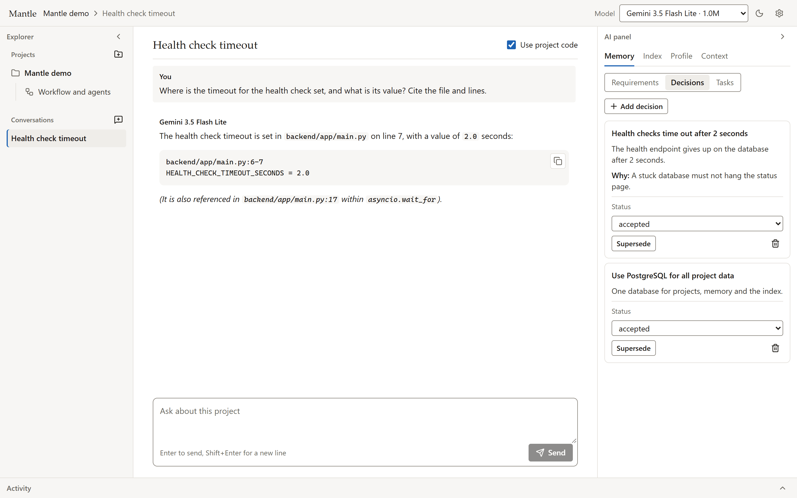
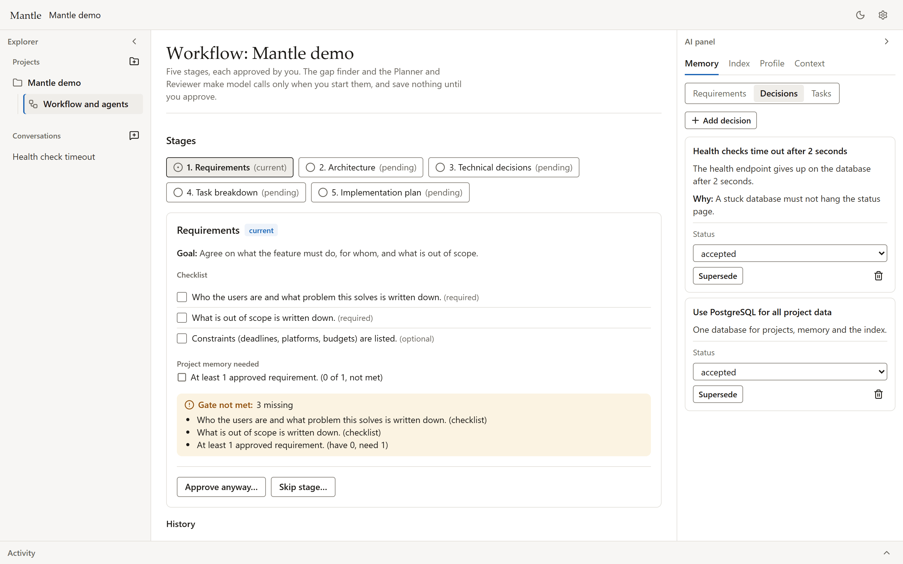
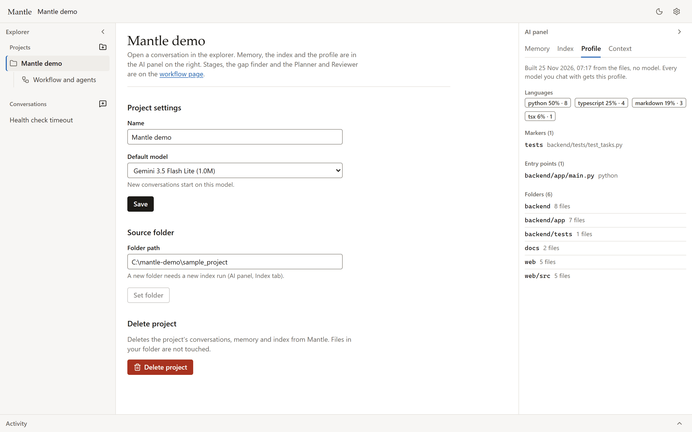

# Mantle AI

Mantle is a local, open-source workspace for building software with several LLMs. It is not an
LLM: it calls the providers you choose, with your own API keys.

[Live site](https://mohammadanas-07.github.io/MantleAI/) · [](https://github.com/MohammadAnas-07/MantleAI/actions/workflows/ci.yml) · [MIT licence](LICENSE)

When a model hits its limit mid-task, you copy the chat into another one and spend a good while
explaining the project again. Mantle keeps the project's requirements, decisions, tasks,
a rolling conversation summary and the indexed code in a local database, so the next model picks
up where the last one stopped. It is for one developer on their own machine ([idea](docs/idea.md)).

## What it does

Works today, in the API and the web app:

- Projects, encrypted provider keys with a test call, and streaming chat.
- Model switching mid-conversation, with a preview. The old model is never called.
- Project memory (requirements, decisions, tasks), pinned into every prompt.
- Indexing a local folder, hybrid code search, and answers that cite `path:lines`.
- A project profile (languages, dependencies, commands) read from the files without a model.
- The workflow page: five stages with human approval, a gap finder, and Planner and Reviewer
  runs whose drafts are saved only when you approve them.

What comes next is in the [roadmap](docs/roadmap.md).

## Screenshots

Taken from the running app on a demo project built from the public sample in
`backend/tests/fixtures`, with Gemini 3.5 Flash Lite.



A chat reply that cites the code it used as `path:lines`.



The workflow page: a stage can't be approved until its gate is met, unless you give a reason.



The project profile, read from the files without a model.

## How it works

One FastAPI process, split into modules, with PostgreSQL 16 and pgvector in Docker, and a React
app in the browser. Every model call goes through one gateway module (built on LiteLLM), which
logs it to a usage table. A context builder assembles each prompt from the system prompt, pinned
memory, the project profile, the rolling summary, retrieved code and recent messages, within the
target model's token budget. Details: [docs/architecture.md](docs/architecture.md).

## Quick start

You need Python 3.12 or newer, Docker Desktop (running), Node.js 22 or newer, and Git. Commands
are for Windows PowerShell; [docs/setup.md](docs/setup.md) explains each step and common errors.

```powershell
docker compose up -d                       # PostgreSQL on 127.0.0.1:5433
cd backend
python -m venv .venv
.venv\Scripts\Activate.ps1
pip install -e ".[dev]"
Copy-Item .env.example .env                # put the next line's output after MASTER_ENCRYPTION_KEY=
python -c "from cryptography.fernet import Fernet; print(Fernet.generate_key().decode())"
alembic upgrade head
python -m app.db.seed                      # default local user and model catalog
uvicorn app.main:app --reload              # http://127.0.0.1:8000, docs at /docs
```

Without the master key the API won't start; if you lose it, saved provider keys can't be read.
In a second terminal, run `cd frontend`, `npm install` and `npm run dev`, then open
<http://127.0.0.1:5173> and add a provider key in the settings. A free Google AI Studio key is
enough for chat and for indexing. The web app follows [docs/design-app.md](docs/design-app.md)
(light theme by default, dark theme in the top bar).

Landing page: <https://mohammadanas-07.github.io/MantleAI/>, built from `landing/` and deployed
by GitHub Actions. How to run, build and host it is in [landing/README.md](landing/README.md).

## Indexing a project

> Warning: indexing sends your code to your embedding provider. Every indexed file is split into
> segments and each one is sent to the provider of your embedding model (by default Google,
> `gemini/gemini-embedding-001`). Every chat message in an indexed project is sent there too, as
> the search query. Free tiers (for example the free Gemini API tier) may use what you send to
> train their models. Don't index code you are not allowed to share with that provider.

Mantle skips `.env*` files, keys and certificates, credential files, binaries, files over 1 MB,
anything `.gitignore` matches, and any file whose content looks like it holds a secret. This is a
safety net, not a guarantee (full list in [docs/security.md](docs/security.md)). A cost estimate
comes first, and indexing above `INDEX_COST_LIMIT_USD` (default $1.00) needs `force`. Each run
also rebuilds the project profile ([setup](docs/setup.md#the-project-profile)).

## Privacy and security

What leaves your machine, and when:

- Your messages and the prompt Mantle builds go to the chat model you picked, when you send.
- Indexed code, and each chat message in an indexed project, go to the embedding provider.
- The rolling summary is the only call you don't start yourself. It goes to the utility model,
  shows on its own line in the usage view, and can be turned off.
- "Test key" makes one tiny call to that provider.

Everything else stays in the local PostgreSQL volume. Provider keys are stored encrypted and never
returned or logged. Logs hold ids, counts and error codes, not prompts, replies or file contents.
Mantle never writes to your project folder and runs no shell commands. The API has no login and
answers only your own computer (unless `ALLOW_REMOTE_CLIENTS` is on); the database listens only
on `127.0.0.1`. Don't expose either on a network. Details: [docs/security.md](docs/security.md).

## Before you run it

- There is no login. Run Mantle only on your own machine and don't expose it on a network.
- Indexing sends your code to your embedding provider (see [Indexing a project](#indexing-a-project)).
- Chat and model switching have been run for real only on Gemini models.
- Index and agent runs live in the server process; a restart stops them.
- All data sits in one Docker volume with no automatic backup ([backup and restore](docs/setup.md#backup-and-restore)).

More known issues: [docs/known-issues.md](docs/known-issues.md). MIT licensed ([LICENSE](LICENSE)).

## Tests and contributing

From `backend`: `pytest`, `ruff check .` and `ruff format --check .`. From `frontend`:
`npm run typecheck`, `npm run lint`, `npm run test` and `npm run build`. Tests need no API keys
and no network. pytest needs a `TEST_DATABASE_URL` database ending in `_test` (see setup).
CI (`.github/workflows/ci.yml`) runs these checks, `npm run format:check` and
`npm run gen:api:check` on every pull request and on every push to `main`.

Read [CLAUDE.md](CLAUDE.md) and [docs/rules.md](docs/rules.md) first. One roadmap item per
branch, named `type/short-topic` (`feat`, `fix`, `docs`, `chore`, `refactor`, `test`). Commits
are `type: short lowercase message`. Nobody commits to `main`; every change goes through a pull
request. Never commit a `.env` file.
